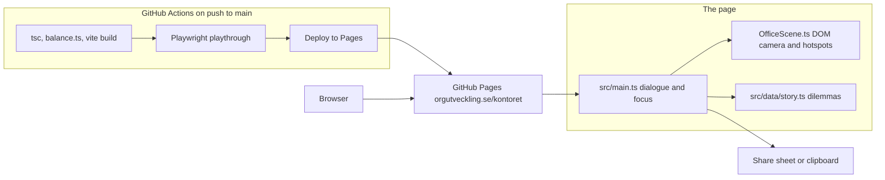

# Context

## Product intent

`Kontoret` is a short Swedish point-and-click leadership game for a broad LinkedIn audience. The tone is workplace recognition, dry absurdity, and punch-up humour. The eventual game will use credible organisational psychology, but this first release intentionally validates only the interaction and visual language.

## Current game loop

- Intro with one button. No avatar, no name: the player is first person and never shown.
- One richly illustrated office as a living tableau. Drag to pan where the viewport crops it.
- Four colleagues baked into the image. Five dilemmas in fixed order (Liv, Nadja, Göran, Mira, Liv), each with three answers scored on tydlighet, trygghet and delaktighet. Earlier answers change later openers.
- Result screen with one of four archetypes (Dirigenten, Diplomaten, Kaptenen, Mötesbokaren), one plain sentence per axis (no bars: five choices are not a measurement, and the screen says so), a closing line that reflects what actually happened, one sourced research sentence and one reading pointer. See `STORY.md`.
- Result can be shared: native share sheet on phones, clipboard elsewhere. Link previews use `public/assets/og-card.png` (1200×627 PNG, LinkedIn does not render WebP).
- Muted-by-default CC0 sound, keyboard navigation, reduced motion, responsive framing.
- Stateless by decision (2026-09-01): nothing is stored between visits. A LinkedIn visitor plays once; remembering a result would only complicate the restart button.

## Technical decision

The scene is one image plus hotspots and a camera, all plain DOM since 2026-09-01: a `.world` div holding the tableau, absolutely positioned hotspot elements, a CSS `transform` with a transition as the camera, pointer events for drag-pan, and CSS keyframes for the three light sources. Phaser was dropped because it cost 1,4 MB of JavaScript for that job; the bundle is now 21 kB. Semantic HTML owns setup, dialogue, focus, and accessibility. Vite and TypeScript are local tooling only. `npm run build` produces static files under the `/kontoret/` base path.

Free walking was dropped on 2026-08-27. The product is the dialogue; a walking sprite required a separate character pipeline (walk cycle, matched scale, occlusion) that AI image generation cannot deliver consistently, and it produced every visual defect in the rejected slice. Assets are produced by editing the accepted concept image, never by compositing separately generated pieces.

## Architecture

Static game with no backend and nothing stored between visits.

## Stack

- Frontend: plain DOM and semantic HTML, no framework (Phaser dropped 2026-09-01)
- Code: TypeScript, Vite as local build tooling, base path `/kontoret/`
- Fonts: Pixelify Sans via `@fontsource`, system sans for running text
- Data: `src/data/story.ts`, no backend, nothing stored
- Tests: Playwright playthrough, `scripts/balance.ts` and node:test unit tests (`scripts/story.test.ts`, `scripts/scene.test.ts`) in the build
- CI: GitHub Actions builds, tests and deploys to Pages on push to `main`
- Hosting: GitHub Pages, orgutveckling.se/kontoret

## Visual direction

Pixelify Sans carries headings, labels and buttons. Running text (dialogue, choices, result paragraphs) is a system sans since 2026-09-01: the pixel face at 13 to 18 px was hard to read and drew "fi" as one glyph. Ligatures are off globally.

Premium contemporary pixel art with late-1990s adventure-game memory, Nordic winter light, teal and amber accents, strong silhouettes, cinematic widescreen composition, and no copied characters or locations. The accepted reference is `art/concepts/office-dialogue-concept.png`.

## Audits
Read by the cockpit Audits tab. One `- Label: YYYY-MM-DD, result` per check; conventions in elwyn-dash `docs/security.md`.
- Headers: 2026-09-16, pass, 6 of 6 on orgutveckling.se/kontoret via the zone Transform Rule and HSTS
- TLS: 2026-09-16, pass, SSL Labs A+ on orgutveckling.se after TLS 1.2 minimum was set today, HSTS present
- Lighthouse: 2026-09-16, warn, a11y 100, best practices 92 (console errors, label-content mismatch), SEO 100 (mobile, no perf)
- Markup: 2026-09-16, pass, W3C 0 errors, 19 warnings, 0 broken links
- npm audit: 2026-11-24, pass, 0 findings (2026-11-17: fail, 4 high via picomatch; the advisory was withdrawn 2026-11-18)
- Secrets: 2026-09-24, pass, gitleaks 0 findings in 14 commits
- Actions: 2026-09-24, pass, zizmor 0 high, 0 medium, 0 low
- WCAG 2.2 AA: 2026-11-25, warn, axe 4.14.0 0 violations on orgutveckling.se/kontoret in intro, scene, dialogue, answer and result at 390 and 1440, and on the 404 page; manual keyboard pass not done
- Performance: 2026-11-25, pass, live at 390 px with 4x CPU and Slow 4G: start button ready 3,9 s (was 4,46), LCP 1,47 s (was 1,43), CLS 0; at 1440 LCP 0,22 to 0,33 s; 595 kB per session (was 656); hashed assets max-age=14400, not immutable
- UX: 2026-11-24, warn, 6 of 6 script checks pass (local preview, --interact), screenshot review at 390 and 1440 done; open: no progress shown across the five talks (Goal-Gradient)
- Headers (automated): 2026-10-27, pass, 6 of 6 on orgutveckling.se/kontoret, Observatory B+ on orgutveckling.se
- Secrets (automated): 2026-10-06, pass, 2 targets; 0 failed, 0 blocked; evidence C:/dev/aifabriken/.runs/audits/2026-10-06-batch-a/kontoret.json
- Actions (automated): 2026-10-06, pass, zizmor 0 high, 0 medium, 0 low; evidence C:/dev/aifabriken/.runs/audits/2026-10-06-batch-a/kontoret.json
- Markup (automated): 2026-10-06, pass, 1 targets; 0 failed, 0 blocked; evidence C:/dev/aifabriken/.runs/audits/2026-10-06-batch-a2/kontoret.json
- WCAG 2.2 AA (automated): 2026-10-06, blocked, 1 targets; 0 failed, 1 blocked; evidence C:/dev/aifabriken/.runs/audits/2026-10-06-batch-a2/kontoret.json
- OG image: 2026-10-25, pass, 1200x627 PNG, https://orgutveckling.se/kontoret/assets/og-card.png
- Database: 2026-10-25, none, static site
- OWASP Top 10: 2026-10-30, warn, code review (Mistral Large, medium and high checked by Claude), no live probe; 0 high, 1 medium: zone CSP allows script-src unsafe-inline, no injection sink found
- Dependabot: 2026-10-29, pass, 0 open alerts
- Mutation: 2026-11-24, Stryker OfficeScene.ts 99,59 % (not measured before, no unit tests), 241 mutants, 1 equivalent survivor (line 89, moved flag set again on line 91); story.ts 97,67 % (2026-11-04); main.ts not measured (DOM glue, covered by Playwright)
